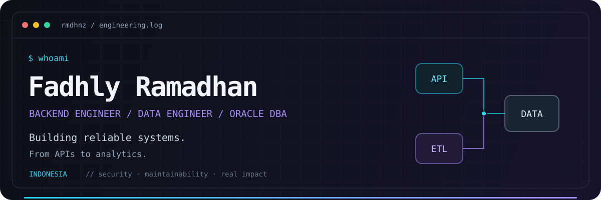

<p align="center">
  
</p>

<h1 align="center">Hi, I'm Fadhly 👋</h1>

<p align="center">
  <strong>Backend Engineer · Data Engineer · Oracle DBA</strong><br />
  Based in Indonesia. Turning business workflows into dependable services and useful data.
</p>

<p align="center">
  <a href="https://github.com/rmdhnz?tab=repositories"></a>
  <a href="https://github.com/rmdhnz"></a>
</p>

<p align="center">
  <a href="#about">About</a> &nbsp; / &nbsp;
  <a href="#stack">Tech stack</a> &nbsp; / &nbsp;
  <a href="#projects">Selected work</a> &nbsp; / &nbsp;
  <a href="#stats">GitHub stats</a> &nbsp; / &nbsp;
  <a href="#connect">Connect</a>
</p>

---

<a id="about"></a>

## `01` / Behind the terminal

My background is in **Electrical Engineering, with a focus on signal processing and data**. Today, I work in production **Oracle database operations** while building backend and data-engineering projects.

I care about the parts that make software dependable: clear data models, secure APIs, maintainable integrations, and services that teams can confidently operate.

```yaml
fadhly:
  handle: "@rmdhnz"
  location: Indonesia
  current_work: Oracle database operations
  building: [backend services, ETL pipelines, AI-enabled backends]
  engineering_values: [reliability, security, maintainability]
  direction: robust data platforms and scalable software systems
```

| Where I work | What I focus on |
| :--- | :--- |
| **Database operations** | Monitoring, incident handling, backups, access management, and production support |
| **Backend engineering** | REST APIs, authentication, authorization, and modular services |
| **Data engineering** | ETL pipelines, dimensional modeling, data quality, and analytics-ready warehouses |
| **Applied AI** | Practical agents and retrieval-enabled product backends |

<a id="stack"></a>

## `02` / Tools of the trade

**Backend & APIs**

<p>
  
</p>

**Databases, data & messaging**

<p>
  <br />
  
  
  
</p>

<details>
<summary><strong>Also in my toolkit → frontend & infrastructure</strong></summary>

<br />

<p>
  
</p>

React, Next.js, and Tailwind for interfaces; Docker, Nginx, Git, and Linux for development and delivery.

</details>

<a id="projects"></a>

## `03` / Selected builds

### 🔐 HRIS Authentication Service

**Secure access, explicit permissions, traceable sessions.** A production-minded authentication service built with NestJS, PostgreSQL, and Prisma.

`NestJS` `PostgreSQL` `Prisma` `JWT` `Docker`

<details>
<summary><strong>Explore the engineering details</strong></summary>

- JWT authentication with refresh-token rotation and session revocation
- API-key protection, role-based access control, and audit logs
- Consistent API response contracts and environment-specific configuration
- Docker-based development workflow

</details>

### 🛒 E-commerce & AI Sales Agent Platform

**From customer conversations to order fulfillment.** A backend for an alcoholic-beverage retailer, connecting POS, payments, delivery, WhatsApp, and AI-assisted customer interaction.

`Laravel` `React` `FastAPI` `MySQL` `RabbitMQ` `Gemini` `BM25`

<details>
<summary><strong>Explore the integrations & AI workflow</strong></summary>

- QRIS payment flow and order lifecycle handling
- Inventory and promotion synchronization across integrations
- Delivery pricing and voucher workflows
- FastAPI workers, RabbitMQ messaging, and external API integrations
- Retrieval-assisted conversational agent using Gemini and BM25

</details>

### 📊 E-commerce Data Warehouse ETL

**Transactional data, ready for analysis.** A Python pipeline that transforms e-commerce records into a dimensional warehouse.

`Python` `ETL` `Star Schema` `Data Quality`

<details>
<summary><strong>Explore the data model & pipeline</strong></summary>

- Customer, product, category, and date dimensions
- Sales fact table for an analytics-ready star schema
- Data validation before downstream analysis
- Command-line workflow for repeatable ETL execution

</details>

<p align="right"><a href="https://github.com/rmdhnz?tab=repositories">Browse my public repositories →</a></p>

<a id="stats"></a>

## `04` / GitHub telemetry

<p align="center">
  <a href="https://github.com/rmdhnz">
    
  </a>
</p>
<p align="center">
  <a href="https://github.com/rmdhnz?tab=repositories">
    
  </a>
</p>

<p align="center"><sub>Cards reflect public repository data and refresh periodically. Language usage is not a measure of proficiency.</sub></p>
<p align="center"><a href="https://github.com/rmdhnz?tab=overview">View contribution activity on GitHub →</a></p>

<!-- Stats provider: https://github.com/anuraghazra/github-readme-stats
     The public endpoint is best-effort and may be rate-limited.
     If needed, deploy your own instance and replace the two image URL hosts above.
     Never put a GitHub token in README URLs. -->

<a id="connect"></a>

## `05` / What's next?

I'm pursuing opportunities where **database reliability, backend engineering, and data systems meet**: Data Engineer, Data Platform Engineer, Backend Engineer, and System Analyst / Architect roles.

I enjoy turning ambiguous business workflows into well-modeled data, reliable integrations, and observable services. If that overlaps with what you're building, let's connect.

<p>
  <a href="https://github.com/rmdhnz"></a>
</p>

<!-- Add a verified LinkedIn or email link here when available. -->

---

<p align="center">
  <code>build → observe → learn → improve</code><br /><br />
  <sub>Building reliable systems, one well-designed service and dataset at a time.</sub><br /><br />
  <a href="#">↑ Back to top</a>
</p>
